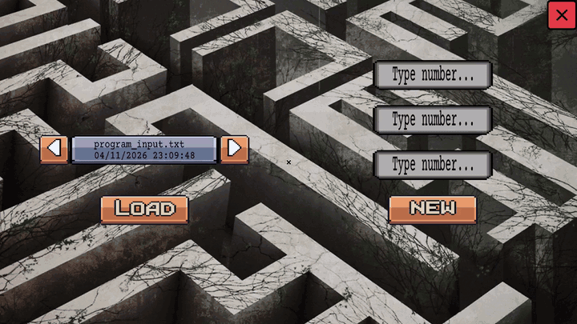

# amazed



Epitech project (B-CPE-200). A C program that finds paths for a group of robots through a network of rooms linked by tunnels, so that they all reach the end room in as few moves as possible.

## Build

```
make
```

This builds the `amazed` binary. `make bonus` builds `amazed_bonus`, a graphical version that needs CSFML.

## Usage

The maze description is read on standard input:

```
./amazed < maze.txt
```

The input gives the number of robots, the rooms (with `##start` and `##end` markers), and the tunnels between them. The program echoes the maze, then prints the moves turn by turn after `#moves`, one line per turn, in the form `P1-room P2-room`.

The program exits with code 84 on an invalid maze or when no path exists. Example inputs for the bonus are in `bonus/test_files`.

## Layout

- `src/parsing`: reading rooms, tunnels and robots
- `src/algo`: path search and robot movement
- `src/utils`: lists and string helpers
- `bonus`: CSFML visualisation
